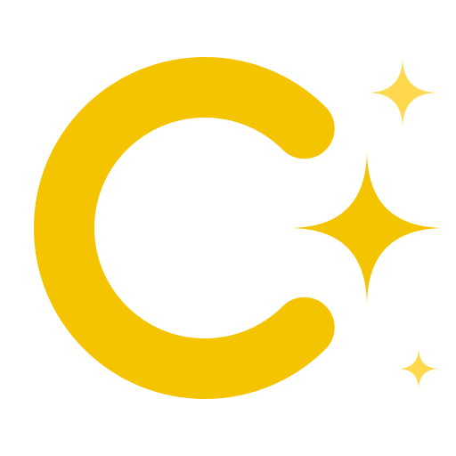

<p align="center"></p>

# Clarity

A development environment that keeps humans in control of AI-assisted codebases. An application is written in Clarity, its own language: windows are designed visually, the behavior behind them is written in Clarity, and Clarity transpiles both into real frontend and backend code. How to use it is in [the manual](docs/manual/README.md), one topic per page. The language is described in full in [docs/LANGUAGE.md](docs/LANGUAGE.md), the design and its reasons in [docs/DESIGN.md](docs/DESIGN.md).

Five stacks are generated: Rust, C#, Go, C and C++. Every desktop program draws its windows with Clarity.UI, Clarity's own UI framework, and each stack can also serve the same windows to a browser, where Clarity.UI draws them as WebAssembly. Each window, view and the app is a `.cxaml` file in the project's `design` folder; entities, themes, code, functions and actions are Clarity text in the project's modules. What is built and what is planned is in the roadmap in docs/DESIGN.md and in the plans next to it in `docs/`.

## Layout

```text
crates/clarity-spec/     lexer, parser, checker, neutral model, sample data, structural edits
crates/clarity-project/  the project file: stack, output and data sources; the project open in the IDE; the activity log of outside agents
crates/clarity-db/       reads the schema of databases Clarity does not own, to import their tables
crates/clarity-vault/    Clarity's vault of secrets and its connections
crates/clarity-gen/      the transpiler: a project as a Rust, C#, Go, C or C++ application
crates/clarity-wasm/     compiles an engine written in Clarity to WebAssembly
crates/clarity-agent/    Clarity's agent: a conversation with a model that works on a project through tools
crates/clarity-tools/    the tools every agent designs and generates with, shared by the Agent panel and `clarity mcp`
crates/clarity-mcp/      Clarity as an MCP server, so an agent you already use works on the open project
crates/clarity-acp/      Clarity as an ACP client, so the Agent panel talks to Codex or GitHub Copilot with your own login
crates/clarity-cli/      the `clarity` command
runtimes/rust/           the runtime of generated Rust applications (the clarity-runtime crate)
runtimes/rust-engine/    what an engine written in Rust stands on (the clarity-engine crate): the engine interface, typed functions, services
runtimes/rust-ui/        Clarity.UI: draws every generated program's windows itself, with Skia
runtimes/rust-ui-ffi/    Clarity.UI's C interface, which C#, Go, C and C++ call
runtimes/rust-ui-browser/ Clarity.UI compiled to WebAssembly, for web programs and the IDE's designer and preview
runtimes/rust-audio/     Clarity.Audio, behind the sound part (with its C interface in rust-audio-ffi)
runtimes/rust-video/     Clarity.Video, behind the video part (with its C interface in rust-video-ffi)
runtimes/rust-image/     Clarity.Image, the picture functions of code (with its C interface in rust-image-ffi)
runtimes/csharp/         the runtime of generated C# applications
runtimes/go/             the runtime of generated Go applications, on Clarity.UI through cgo
runtimes/c/              the runtime of generated C applications, with cJSON
runtimes/cpp/            the runtime of generated C++ applications
runtimes/web/            the part of Clarity's model the IDE's front end shares
conformance/             cases every runtime and renderer must pass alike
editors/vscode/          colors for .clarity files in VS Code (and JetBrains, through TextMate bundles)
app/                     Clarity IDE: Tauri 2 + Svelte 5
  src-tauri/             Rust side: loads, watches and edits projects; Run and Build; the Agent panel
docs/manual/             the manual, one topic per page; the IDE opens it with F1
examples/                example projects, each a project file with a folder of its modules and a README, on the stack it names:
  shop                   Rust    customers and orders, priced by an engine
  dashboard              Rust    sales and stock at a glance: charts, totals and the products running low
  modelling              Rust    a data model kept in one place, from which the app writes what developers would write by hand
  network                Rust    graphs of records: people, organisations and projects from the data model, and free ideas with their links
  records                Go      a record collection, with albums, tracks and loans; an engine reads photo sizes
  calculator             Go      a calculator: values in clicks, plain window data, a seven-segment display
  dial                   Go      a speed dial drawn on a canvas by code, its needle placed by an engine
  stock                  Go      a stock list with a window and a command line over the same items
  waves                  Go      water whose waves meet, drawn by a Go package into a buffer of pixels (a custom part in Go)
  pills                  Go      a game like Arkanoid, breaking a wall of pills: its engine beside the screen, written in Clarity and run by its interpreter
  videoplayer            Go      plays videos with the video part
  invaders               Go web  a fleet that marches down and you shoot it: a game served to a browser
  todo                   C#      tasks with a done flag, edited in their table
  noughts                C#      noughts and crosses against an engine written in Clarity that keeps each window's game
  mp3player              C#      plays music with the sound part
  ledger                 C# cli  a command-line program alone: accounts and what is booked on them
  walker                 C# web  a stick figure that walks across the window and back, its timer's handler on the server
  kitchen                C       recipes by course, with their ingredients and a photo
  orbs                   C++     a game whose field of orbs a custom part draws
  novel                  C++     books and their chapters, fragments and progress, for writing a novel, a screenplay or a play
  build-engines.sh       builds the examples' engines from their sources in <example>/engines/<name>/
```

Generated applications get their runtime as a package: Rust from crates.io (`clarity-runtime`), Go as a module (`github.com/petervdpas/Clarity/runtimes/go`), C# from NuGet (`Clarity.Ui` for a desktop program, which brings Clarity.UI's native library and `Clarity.Runtime`; `Clarity.Ui.Server` for a web server, which serves Clarity.UI's browser files; a driver package per kind of database, such as `Clarity.Runtime.Sqlite`; and `Clarity.Runtime.Engines` for engines). The C and C++ runtimes are copied into every application, so it builds on its own. Their tests sit where the language keeps them: `runtimes/rust/tests`, `runtimes/csharp/*.Tests`, the `_test.go` files next to the Go code, and `runtimes/c/tests` and `runtimes/cpp/tests` (built with CMake, run with `ctest`). A custom part is a library of the project in its own language (a Rust crate, a Go package, C or C++ with CMake, C# with NuGet): the program builds it in and Clarity.UI draws it; see [Custom parts](docs/manual/design.custom-parts.md).

## Requirements

- Rust 1.88 or newer (edition 2024)
- Node.js 20.19, or 22.12 or newer (what Vite asks)
- On Linux: the Tauri system libraries (WebKitGTK 4.1, GTK 3, libsoup 3)
- For C applications: CMake 3.25 or newer, a C17 compiler, pkg-config, and the SQLite 3 development package (`libsqlite3-dev` on Debian)
- For C++ applications: CMake 3.25 or newer, a C++20 compiler, pkg-config, and the SQLite 3 and nlohmann-json development packages (`libsqlite3-dev nlohmann-json3-dev` on Debian)
- For Go, C and C++ applications with a window: the Clarity.UI library (`libclarity_ui`, built from `runtimes/rust-ui-ffi`) and its header. Clarity's installer carries it; a Clarity built from source fetches it from its GitHub release on the first build (as a generated C or C++ project's CMake does, built without Clarity); the environment variable `CLARITY_UI` names a folder of your own instead (`include/` and `lib/`)
- For C# applications: the .NET 10 SDK (a web application gets Clarity.UI's browser files from Clarity, as the other languages do)

### Setting up the tools

What to install on Windows, Linux and macOS, step by step with the commands, is in the manual: [Setting up the build tools](docs/manual/setup.tools.md). Clarity opens that page itself, at the right part, from **How to install** beside a missing tool (Clarity settings, Environment, and Build tools in the project settings). On Windows, C and C++ come from MSYS2's UCRT64 shell, every tool from that one prefix.

## Commands

The installed Clarity has the `clarity` command-line tool beside the IDE (`/usr/bin/clarity` on Linux, the install folder on Windows), at the IDE's version: `clarity gen shop.clarity`, `clarity data migrate`, `clarity --help`. Built from source, it is `cargo run -p clarity-cli --`, as below.

Check a project:

```sh
cargo run -p clarity-cli -- spec check examples/shop.clarity
```

Print the checked model as JSON, optionally with the preview's sample rows:

```sh
cargo run -p clarity-cli -- spec model examples/shop.clarity --samples
```

Generate the application into the project's output folder (`examples/shop/out`), which `cargo build` there turns into a program:

```sh
cargo run -p clarity-cli -- gen examples/shop.clarity
```

Look for the build tools of every stack, and what to install:

```sh
cargo run -p clarity-cli -- tools
```

Run the tests. This also regenerates the TypeScript bindings in `runtimes/web/src/generated/`:

```sh
cargo test
```

Start the app from the project root (it installs the npm packages on first run):

```sh
mkdir -p /tmp/try && cp -r examples/shop examples/shop.clarity /tmp/try/   # the designer edits files in place
./dev.sh /tmp/try/shop.clarity
```

On Windows, `dev.bat` takes the same arguments: `dev.bat %TEMP%\try\shop.clarity`.

A project is one file, `shop.clarity`, with its modules in the folder `shop/` next to it and a `.cxaml` file per window in `shop/design/`. Without a file, `./dev.sh` or `dev.bat` opens the project used last time. In the IDE, **Open** on the Project tab browses for a project anywhere in Clarity's own browser, which shows each Clarity project as a card with its stack and the start of its README, keeps the last ten opened, and makes a new project in the folder you are in; see [Opening a project](docs/manual/start.overview.md#opening-a-project). Edit the files in any editor; the designer and the preview follow every save, and every change in the designer is written straight to the files, so point it at a copy if you only want to experiment.

How to work in the IDE (the ribbon's Project, Design, Preview and Vault tabs, the designer, Run and Build, the Agent panel) is in the manual, starting with [What Clarity is](docs/manual/start.overview.md).

Type-check the frontend:

```sh
cd app
npm run check
```

## AI agents

Clarity's own agent works in the Agent panel through a connection in the vault, such as an Anthropic API key; see [The agent](docs/manual/ai.agent.md). Two more ways use an agent you already pay for, with no API key in Clarity:

- **Your agent in Clarity:** Codex (with `codex-acp`) or the GitHub Copilot CLI in the Agent panel, started by Clarity and signed in with the vendor's own login. See [Your own agent in Clarity](docs/manual/ai.your-agent.md).
- **Clarity in your agent:** Claude Code, Codex or Copilot starts `clarity mcp` and designs and generates the project open in the IDE with Clarity's tools: `claude mcp add --scope user clarity -- clarity mcp`. See [Clarity in your own agent](docs/manual/ai.mcp.md).

`clarity mcp` never builds or runs. In the panel, Clarity's own agent runs or builds only as **Clarity settings** allow (it asks each time by default), and Codex or Copilot asks before every command it runs, apart from commands that only read, which Codex runs in its read-only sandbox. The same settings section turns outside agents off and shows each tool call they make.

## License

MIT; see [LICENSE](LICENSE). The C runtime includes cJSON under its own MIT license (`runtimes/c/third_party`).
