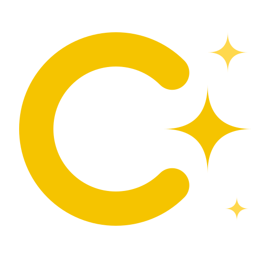

<p align="center"></p>

# Clarity

A development environment that keeps humans in control of AI-assisted codebases. An application is written in Clarity, its own language: windows are designed visually, the behavior behind them is written in Clarity, and Clarity transpiles both into real frontend and backend code. How to use it is in [the manual](docs/manual/README.md), one topic per page. The language is described in full in [docs/LANGUAGE.md](docs/LANGUAGE.md), the design and its reasons in [docs/DESIGN.md](docs/DESIGN.md).

Current state: the designer for windows and the application frame, with every part on a fluid snap grid (S1 to S3e); projects as one file with their settings (P1, P2); handlers in the code behind and functions and actions in modules, written in Clarity (L1, L2); window and app events (E1); forms, labels and help texts (U1a); queries and migrations written in Clarity (D1a, D1b); and the Rust generator, which turns a project into a Tauri desktop application with SQLite that Clarity builds and runs (G1). See the roadmap in docs/DESIGN.md.

## Layout

```text
crates/clarity-spec/     lexer, parser, checker, neutral model, sample data, structural edits
crates/clarity-project/  the project file: stack, output and data sources
crates/clarity-vault/    Clarity's vault of secrets and its connections
crates/clarity-gen/      the transpiler: a project as a Rust, C#, Go, C or C++ application
crates/clarity-cli/      the `clarity` command
runtimes/rust/           the runtime of generated Rust applications (the clarity-runtime crate)
runtimes/rust-engine/    what an engine written in Rust stands on (the clarity-engine crate): the engine interface, typed functions, services
runtimes/csharp/         the runtime of generated C# applications, with Avalonia
runtimes/go/             the runtime of generated Go applications, with Wails
runtimes/c/              the runtime of generated C applications, with webview and cJSON
runtimes/cpp/            the runtime of generated C++ applications, with webview
conformance/             cases every runtime and renderer must pass alike
editors/vscode/          colors for .clarity files in VS Code (and JetBrains, through TextMate bundles)
app/                     Clarity: Tauri 2 + Svelte 5
  src-tauri/             Rust side: loads, watches and edits projects; Run and Build
  src/lib/generated/     TypeScript types generated from the Rust model (do not edit)
examples/                example projects, each a project file with a folder of its modules:
  shop                   customers and orders, priced by an engine
  records                a record collection, with albums, tracks and loans; an engine reads photo sizes
  todo                   tasks with a done flag, edited in their table
  calculator             a calculator: values in clicks, plain window data, a seven-segment display
  dial                   a speed dial drawn on a canvas by code, its needle placed by an engine
  noughts                noughts and crosses against an engine written in Clarity that keeps each window's game
  ledger                 a command-line program alone: accounts and what is booked on them, in C#
  stock                  a stock list with a window and a command line over the same items, in Go
  orbs                   a game whose field of orbs a native library draws with SFML (a custom part), in C++
  dice                   dice thrown on a table drawn in 3D with Bevy (a custom part in Rust), with sound and a history of rolls
  waves                  water whose waves meet, drawn by a Go package into a buffer of pixels (a custom part in Go)
  pills                  a game like Arkanoid, breaking a wall of pills: its engine beside the screen, written in Clarity and run by its interpreter, in Go
  invaders               a fleet that marches down and you shoot it: a game served to a browser, the web target, in Go
  walker                 a stick figure that walks across the window and back: C# with Avalonia in the browser, its timer's handler on the server
  build-engines.sh       builds the examples' engines from their sources in <example>/engines/<name>/
```

Generated applications get their runtime as a package: Rust from crates.io (`clarity-runtime`), Go as a module (`github.com/petervdpas/Clarity/runtimes/go`), C# from NuGet (`Clarity.Runtime`, `Clarity.Avalonia`, `Clarity.Avalonia.Desktop` for a desktop program, and a driver package per kind of database, such as `Clarity.Runtime.Sqlite`). The C and C++ runtimes are copied into every application, so it builds on its own. Their tests sit where the language keeps them: `runtimes/rust/tests`, `runtimes/csharp/*.Tests`, the `_test.go` files next to the Go code, and `runtimes/c/tests` and `runtimes/cpp/tests` (built with CMake, run with `ctest`). `runtimes/parts` is the part host of the C and C++ stacks, which runs custom parts written in C or C++, with its tests in `runtimes/parts/tests`; the Rust and Go runtimes host their parts themselves.

## Requirements

- Rust 1.88 or newer (edition 2024)
- Node.js 20 or newer
- On Linux: the Tauri system libraries (WebKitGTK 4.1, GTK 3, libsoup 3)
- For C applications: CMake 3.25 or newer, a C17 compiler and a C++ compiler (for the webview), pkg-config, and the SQLite 3 development package (`libsqlite3-dev` on Debian)
- For C++ applications: CMake 3.25 or newer, a C++20 compiler, pkg-config, and the SQLite 3 and nlohmann-json development packages (`libsqlite3-dev nlohmann-json3-dev` on Debian)
- On Windows, for C and C++ applications: the WebView2 SDK, which the webview builds against (the `Microsoft.Web.WebView2` NuGet package; the runtime itself ships with Windows 11)
- For C# applications: the .NET 10 SDK; for one with the web target (`stack csharp avalonia web`), also .NET's WebAssembly tools, which link Avalonia's drawing into the browser program: `dotnet workload install wasm-tools` (with `sudo` where .NET is installed for the whole system, as on Linux in `/usr/share/dotnet`)

### Setting up the tools

What to install on Windows, Linux and macOS, step by step with the commands, is in the manual: [Setting up the build tools](docs/manual/setup.tools.md). Clarity opens that page itself, at the right part, from **How to install** beside a missing tool (Clarity settings, Environment, and Build tools in the project settings). On Windows, C and C++ come from MSYS2's UCRT64 shell, every tool from that one prefix.

## Commands

Check a project:

```sh
cargo run -p clarity-cli -- spec check examples/shop.clarity
```

Print the checked model as JSON, optionally with the preview's sample rows:

```sh
cargo run -p clarity-cli -- spec model examples/shop.clarity --samples
```

Generate the application into the project's output folder (`examples/shop/out`), which `cargo build` there turns into a program:

```sh
cargo run -p clarity-cli -- gen examples/shop.clarity
```

Run the tests. This also regenerates the TypeScript bindings in `app/src/lib/generated/`:

```sh
cargo test
```

Start the app from the project root (it installs the npm packages on first run):

```sh
mkdir -p /tmp/try && cp -r examples/shop examples/shop.clarity /tmp/try/   # the designer edits files in place
./dev.sh /tmp/try/shop.clarity
```

On Windows, `dev.bat` takes the same arguments: `dev.bat %TEMP%\try\shop.clarity`.

A project is one file, `shop.clarity`, with its modules in the folder `shop/` next to it. Without a file, `./dev.sh` or `dev.bat` opens the project used last time. Edit the `.clarity` files in any editor; the preview reloads on every save.

Clarity has a ribbon with three tabs, and the left sidebar follows the tab:

- **Project:** New project (choose where its file goes; the folder next to it is made too), Open (a `.clarity` project file), Reload, Settings (name, title, folders, stack, data sources), New window, the app, and the error count. The sidebar shows the project settings and the project as one tree: the app, its windows (the main window first), its data with their fields, and the modules its files form. Click an entity for its data dictionary (a row per field: name, type, required, unique, label, default, help; add, reorder and remove fields), an enum for its values, and rename either by editing the name at the top: every reference in every file follows, and one Undo takes the whole rename back. Click a module for what it declares and which modules it uses. A change that would break a window is refused with the reason.
- **Design:** Undo and Redo (also Ctrl+Z and Ctrl+Y), Delete (the picked part, or the window itself when nothing is picked), New window and the snap grid. Every change is written to the project files at once; the Save button shows that. The sidebar has the project tree, the parts, a tree of the open window and the design settings. The right column shows the window's own properties and, below them, what is picked.
- **Preview:** run the main window or any other window, and go back after following a button.

Every window is designed the same way:

- Drag parts onto a grid cell: frame regions, basic input, containers, data and graphics. Drag a field of the window's data to get a caption label plus a bound input in one step; a list becomes a table.
- Drag parts to move them, also into panels, tabs and splitter panes; drag the corner handle of the picked part to resize it.
- Pick a part on the window or in the Window tab to edit its caption, position, size, binding and part-specific properties. Delete removes it, Escape clears the pick.
- Every part has a name (new parts get one after their purpose, like `vatNumberLabel` or `ordersTable`) and an Events list. **Wire** connects an event to a handler named after the part and the event, such as `on click: saveClick`; the handlers will be written in Clarity in the window's code behind.
- "+ New window" in the Project tab starts a window blank, as a form for an entity, or as a browse for an entity. The templates produce ordinary windows that you then design like any other.

For the application frame (an `app` block, see `examples/shop/shop.clarity`):

- Pick the app in the Project tab to design the menu, toolbar, ribbon, sidebars and footer that every window shows. A window page can have its own regions, which replace the app's; the app's regions show dimmed in its designer.
- Drag Menu, Toolbar, Ribbon, Sidebar or Footer from the Frame parts onto an edge of the window; the edges that accept it light up.
- Click a menu item, button, ribbon tab or group to set its caption, icon, shortcut, size and click target, to add items and submenus, or to move and remove it. Drag widgets onto a sidebar or the footer like onto the page grid.
- In Preview, the menu, toolbar and ribbon open their targets; `close` closes the current window.

Every change is written straight to the `.clarity` file. Only the affected lines change; comments and formatting elsewhere stay as they are. An edit is refused if the file changed on disk in the meantime, or if it would make the spec invalid. Note that the designer edits the files in place, so point it at a copy if you only want to experiment.

Type-check the frontend:

```sh
cd app
npm run check
```

## License

MIT; see [LICENSE](LICENSE). The C and C++ runtimes include cJSON and webview under their own MIT licenses (`runtimes/c/third_party`, `runtimes/cpp/third_party`).
