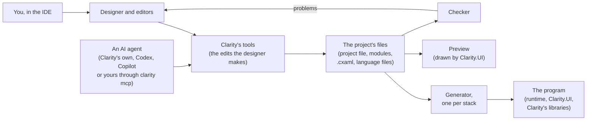
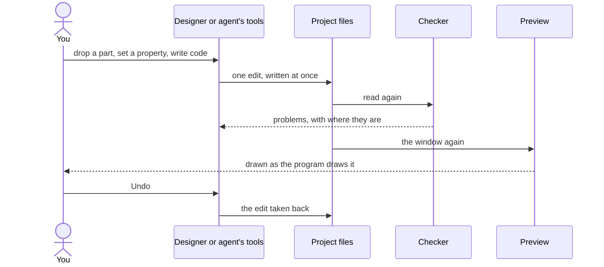
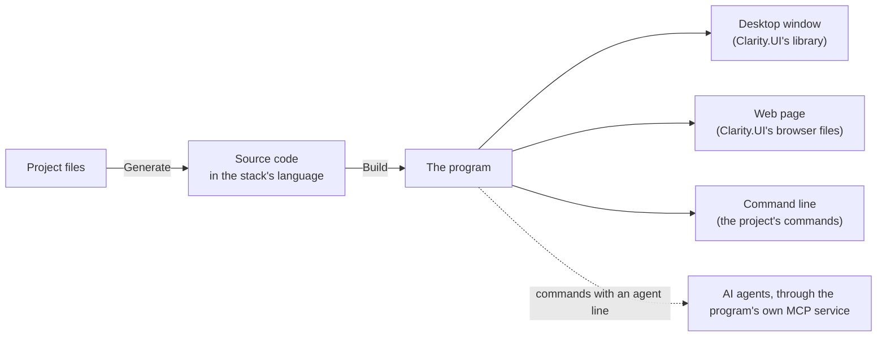
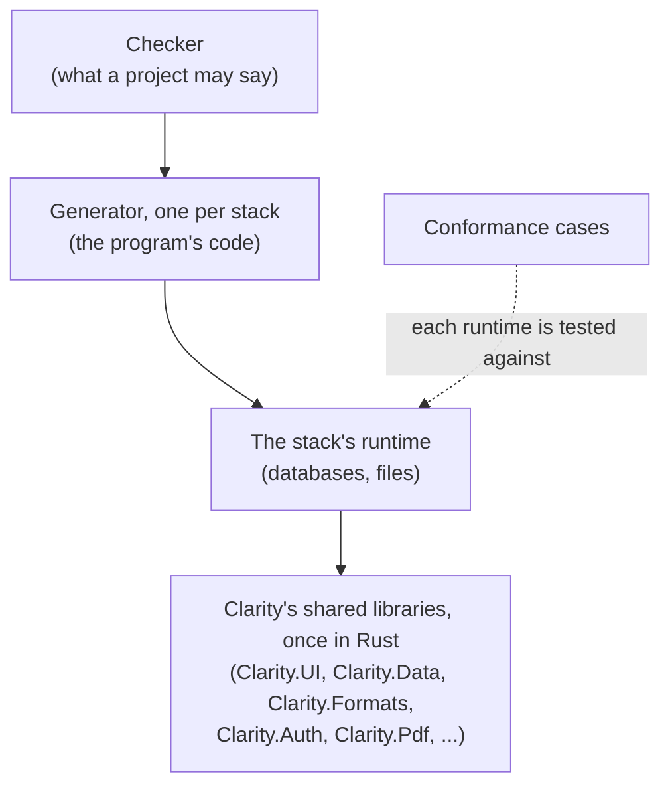

# How Clarity works

What Clarity is made of, and how a design becomes a program: from the designer and the files, through the checker and the preview, to generated source code built on its own stack.

## The pieces

Clarity is one language and an IDE. A project is files you can read: a project file, modules in the Clarity language, a `.cxaml` file per window and view, and the language files. The IDE edits those files, by hand in the designer or through an AI agent's tools, and checks them as they change. Generating turns the project into the source code of a program on its stack (Rust, Go, C, C++ or C#), which that stack's own tools build. Every program draws its windows with Clarity.UI, the same on every stack and in the browser.

## Designing

Every change goes through the same edits, whoever makes it: a drag in the designer, a property changed by hand, or a tool an agent calls. Each edit writes the files at once, the checker reads them again and lists its problems, and the preview draws the window as the program will. Undo takes an edit back, an agent's too.

## From design to program

Generate writes the program's source code into the project's output folder, in the stack's own language and layout. Build runs the stack's own tools on it (cargo, go, CMake, dotnet); Run starts the program. A desktop program draws with Clarity.UI's library, a web program serves Clarity.UI's browser files, and a command-line program runs the project's commands. A command with an `agent` line is offered to AI agents by the program itself, desktop or command line.

## Where each decision is made

A program is generated code on its stack, its stack's runtime, and Clarity's shared libraries. Each decides its own share:

- **The checker** decides what a project may say, before anything is generated: every rule a generator would refuse, the checker says first, with where it is.
- **The generator** of each stack writes the program in that stack's language: its records, windows, code and build files. It decides nothing about values or drawing that the program does not carry out the same way on every stack.
- **The stack's runtime** (the Rust crate, the Go module, the C# packages, the C and C++ sources a program carries) reads and writes the program's databases and files, and calls the shared libraries.
- **Clarity's shared libraries**, written once in Rust and called by every stack through a C interface: Clarity.UI draws every window and decides what a person does in it (a table's order and pages, a tree's rows, a chart's groups, a row moved, a slider stepped), so the program gets only the result, as an edit; Clarity.Data and Clarity.Formats read and write data and its formats, Clarity.Auth signs people in, Clarity.Pdf makes PDFs and reports, and Clarity.Image, Clarity.Audio and Clarity.Video handle pictures, songs and videos.

What every stack must do alike is written down as cases in Clarity's conformance files, which each stack's runtime is tested against.

## The preview and the canvases

The IDE's own window is a web view, so the Preview and Design canvases draw with Clarity.UI's browser files: the same Rust code a desktop program draws with, compiled for the browser, the same files a web program serves. A window looks the same in the preview as in the program, whatever stack the project is on. The built program itself draws on the desktop with Clarity.UI's library, without a browser.

See [Run and Build](project.run-build.md) for Generate, Build and Run, and [Clarity in your own agent](ai.mcp.md) for agents.
