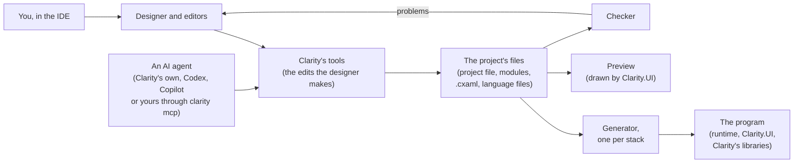
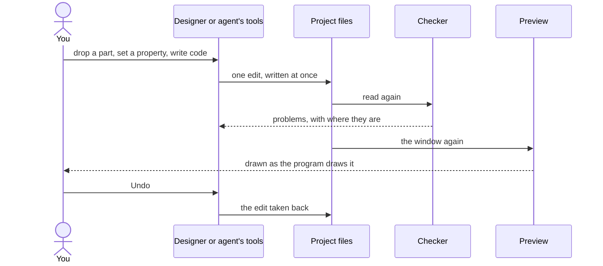
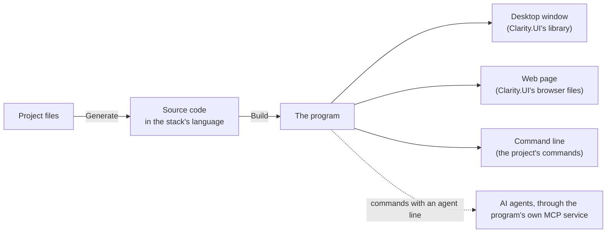

# How Clarity works

What Clarity is made of, and how a design becomes a program: from the designer and the files, through the checker and the preview, to generated source code built on its own stack.

## The pieces

Clarity is one language and an IDE. A project is files you can read: a project file, modules in the Clarity language, a `.cxaml` file per window and view, and the language files. The IDE edits those files, by hand in the designer or through an AI agent's tools, and checks them as they change. Generating turns the project into the source code of a program on its stack (Rust, Go, C, C++ or C#), which that stack's own tools build. Every program draws its windows with Clarity.UI, the same on every stack and in the browser.

## Designing

Every change goes through the same edits, whoever makes it: a drag in the designer, a property changed by hand, or a tool an agent calls. Each edit writes the files at once, the checker reads them again and lists its problems, and the preview draws the window as the program will. Undo takes an edit back, an agent's too.

## From design to program

Generate writes the program's source code into the project's output folder, in the stack's own language and layout. Build runs the stack's own tools on it (cargo, go, CMake, dotnet); Run starts the program. A desktop program draws with Clarity.UI's library, a web program serves Clarity.UI's browser files, and a command-line program runs the project's commands. A command with an `agent` line is offered to AI agents by the program itself, desktop or command line.

See [Run and Build](project.run-build.md) for Generate, Build and Run, and [Clarity in your own agent](ai.mcp.md) for agents.
